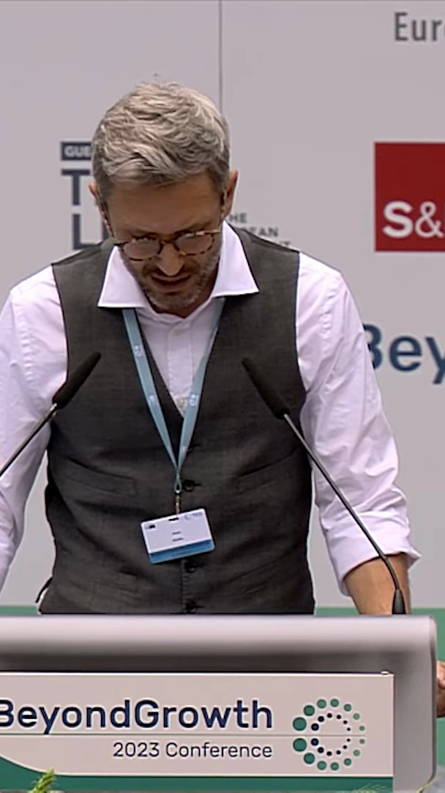
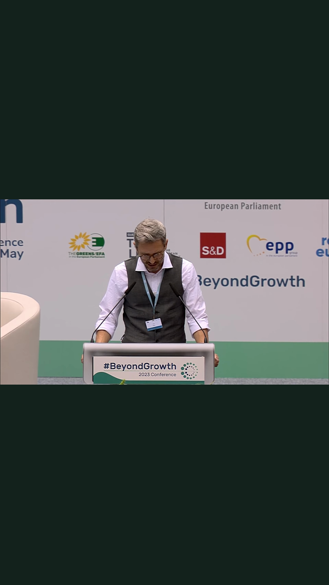

# تقرير مهمة خيارات تأطير الفيديو وجودة التصدير

**المستودع:** `mojtabahamed163-ai/frame-key-studio`  
**الفرع:** `main`  
**نطاق التغيير:** تنفيذ محلي داخل المتصفح؛ لم يتم نشر الموقع.

## 1. التشخيص

سبب ظهور `608×1080` عند تحويل مصدر `1920×1080` إلى 9:16 هو هندسة القص، لا ضغط سيئ: عرض القص الكامل بالنسبة 9:16 يساوي `1080 × 9 / 16 = 607.5`، ويُقرب إلى 608 بكسلات. هذا القص يحتفظ بارتفاع المصدر 1080 ويأخذ شريحة عرضها 608 من أصل 1920؛ أي أن نحو 68.3% من العرض الأفقي خارج الإطار. إعادة ترميز هذه الشريحة إلى 1080×1920 لا تستعيد التفاصيل التي لم تدخل القص، ولذلك يعرض التطبيق الآن تحذيرًا صريحًا عند التكبير بدل وصفها بأنها دقة أصلية.

المسار الحالي يقرأ الفيديو والصوت محليًا عبر Mediabunny، يرسم الإطار النهائي على Canvas، ثم يعيد الترميز إلى VP9/VP8 + Opus أو H.264 + AAC حسب WebCodecs المتاح. الصوت يبقى في مسار مستقل مع القص الزمني نفسه، وتوجد معادلة peak-normalize اختيارية لا تُفعل افتراضيًا. تم الإبقاء على هذا المسار، وتغيير أبعاد اللوحة والرسم والـbitrate فقط حسب الوضع والجودة.

## 2. ما نُفذ

- **Preserve Original:** يخرج بأبعاد المصدر واتجاهه، ولا يطبق قصًا. يسمح codec فقط بتقريب كل بعد إلى رقم زوجي.
- **Vertical 9:16:** يطبق قصًا حقيقيًا بنسبة 9:16، مع منع لوحة أكبر من قدرة المصدر العمودية. لا يدعي استعادة التفاصيل المفقودة.
- **Fit with Background:** يضع كامل الصورة داخل مساحة 9:16، مع خلفية مشتقة من الفيديو ومموهة/مخفضة السطوع أو لون ثابت داكن. الإطار الأساسي يبقى واضحًا وغير ممدد.
- **Smart Framing:** يستخدم تتبع الوجه المحفوظ، والـface keyframes الحالية، وقيود الحركة والـfallback اليدوي الموجودة. عند عدم توفر موضع آمن يبقى أقرب موضع صالح بدل قفزة عشوائية.
- تمت مزامنة المعاينة والتصدير على نفس أسماء الأوضاع، مع الحفاظ على توافق قيم المشاريع القديمة `fill` و`full`.
- أضيفت ملفات جودة فعلية:
  - **High Quality:** `20 Mbps` للفيديو العمودي 1080، `10 Mbps` لـ720، وصوت `160 kbps`.
  - **Balanced:** `12 Mbps` للفيديو العمودي 1080، `6 Mbps` لـ720، وصوت `128 kbps`.
  - **Smaller File:** `8 Mbps` للفيديو العمودي 1080، `4 Mbps` لـ720، وصوت `96 kbps`.
- تقدير حجم الملف يستخدم bitrate الملف المحدد ومدة المقطع بدل رقم ثابت.
- لم تتغير بيانات التفريغ أو الترجمة أو موضع النص أو التتبع عند تغيير الوضع؛ كلها جزء من `StudioProject.settings` المحفوظة محليًا.

## 3. الملفات المعدلة

- `client/src/features/studio/types.ts`
- `client/src/features/studio/export/convert-clip.ts`
- `client/src/features/studio/export/convert-clip.test.ts`
- `client/src/features/studio/components/VideoPreview.tsx`
- `client/src/pages/Studio.tsx`

## 4. الاختبارات البرمجية

- `pnpm check` — ناجح.
- `pnpm test` — ناجح: **19 ملف اختبار، 135 اختبارًا**.
- `pnpm build` — ناجح.
- `git diff --check` — ناجح.
- أضيفت اختبارات تثبت أن مصدر `1920×1080` يعطي:
  - Preserve: `1920×1080` دون قص.
  - Vertical/Fit: `608×1080` عند طلب ارتفاع 1920، وهو القص الهندسي الصحيح.
  - Legacy `fill/full` تتحول إلى `vertical/fit-background`.
  - مستويات الجودة تغير bitrate إلى `20/12/8 Mbps` للخرج العمودي 1080.

تحذير البناء الموجود مسبقًا حول `config.js` غير المرتبط بالتعديل ما زال يظهر كتحذير Vite، لكنه لا يفشل البناء.

## 5. اختبار إعلامي حقيقي مرخّص

استُخدم تسجيل بشري حقيقي من Wikimedia Commons، وليس فيديو مولدًا بالذكاء الاصطناعي:

- المصدر: [BeyondGrowth 2023 Conference — Jason Hickel](https://commons.wikimedia.org/wiki/File:BeyondGrowth_2023_Conference_-_Jason_Hickel_(talk_on_degrowth_or_economics_beyond_'GDP-growth').webm)
- رابط الملف: `https://upload.wikimedia.org/wikipedia/commons/b/b2/BeyondGrowth_2023_Conference_-_Jason_Hickel_%28talk_on_degrowth_or_economics_beyond_%27GDP-growth%27%29.webm`
- الترخيص الموثق في صفحة Commons: CC BY 3.0.
- المصدر الأصلي المفحوص: `1920×1080`, `25 fps`, VP9 + Opus، مدة تقريبية 803.861 ثانية.

أُنشئت عينات قصيرة محلية من المصدر لاختبار هندسة الخرج وفحص السلامة:

| العينة | الأبعاد | المدة | المسارات | الحجم |
|---|---:|---:|---|---:|
| أفقي | 1920×1080 | 8.008 s | VP9 + Opus | 6,494,334 B |
| قص عمودي | 608×1080 | 8.008 s | VP9 + Opus | 4,717,946 B |
| احتواء كامل | 608×1080 | 8.008 s | VP9 + Opus | 2,898,310 B |

كل العينات اجتازت `ffprobe`، وحافظت على الصوت والمدة ومعدل الإطارات، وتم استخراج إطارات عند الثانية الرابعة.

المسارات المحلية الكاملة للمواد غير المضمّنة في Git:

- المصدر: `/home/ubuntu/frame-key-studio/acceptance/task9/beyondgrowth.webm`
- العينات: `/home/ubuntu/frame-key-studio/acceptance/task9/fixtures/`
- الإطارات: `/home/ubuntu/frame-key-studio/acceptance/task9/frames/`

## 6. حدود التحقق

تم فحص خوارزميات الأبعاد، الترميز، الصوت، الإطارات، البناء، والاختبارات الآلية، كما تم فحص صفحة Studio عبر Chromium headless. لم أعتبر ذلك بديلًا عن جلسة تفاعل كاملة داخل متصفح يدعم WebCodecs ورفع ملف محلي وتشغيل Whisper وتتبع الوجه ثم تنزيل ملف التصدير؛ هذه الجلسة الكاملة تحتاج بيئة متصفح تفاعلية/صلاحية ملف محلي. لذلك لا أقدّم ادعاءً جديدًا بأن كل مسارات Whisper والترجمة والتتبع والتصدير التفاعلية أُعيدت من الصفر في هذه الجلسة؛ الاختبارات التاريخية الموجودة في تقارير المشروع السابق تبقى منفصلة ومؤرخة.

## 7. Git

سيُسجل التغيير على `main` بعد انتهاء التحقق. لا يوجد نشر للموقع.
